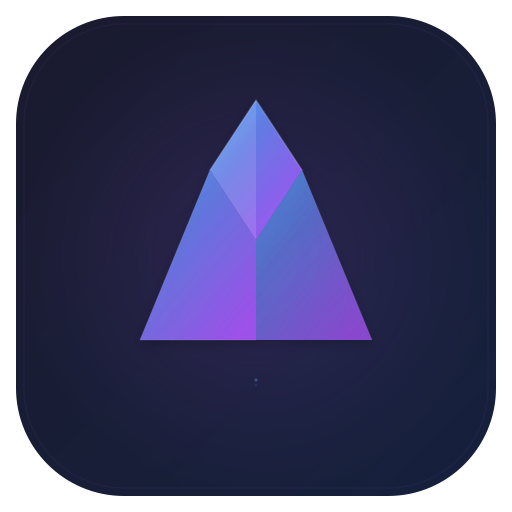

<div align="center">



# Mnemo

**免费的多云桌面文件管理器**

在一个应用中管理多个网盘：浏览文件、上传下载、跨盘迁移、双向同步、创建分享和在线播放。

[](https://github.com/lllll081926i/Mnemo/releases/latest)
[](https://github.com/lllll081926i/Mnemo/actions/workflows/release.yml)
[](https://go.dev/)
[](https://wails.io/)
[](LICENSE)

[下载应用](https://github.com/lllll081926i/Mnemo/releases/latest) · [功能概览](#核心能力) · [从源码构建](#从源码构建) · [项目文档](#文档与参与)

</div>

---

## Mnemo 适合做什么

Mnemo 面向同时使用多个云存储服务的人。它不托管文件、不提供中转账号，直接使用你登录到各网盘的账户和各服务商的官方或兼容接口。

- 在同一界面中浏览和整理多个网盘账户；
- 用原生断点续传下载器管理大量文件传输；
- 在两个面板间复制文件，或把文件迁移到另一家网盘；
- 为本地目录与云端目录建立可预览的双向同步任务；
- 直接预览图片、文本和媒体文件，并使用本地播放代理处理需要鉴权的流媒体。

> Mnemo 尊重服务商的验证码、短信验证、人机校验、频率限制和账号访问策略；不会绕过这些机制。

## 快速开始

### 下载并安装

从 [Releases](https://github.com/lllll081926i/Mnemo/releases/latest) 下载适合系统架构的安装包。每个发布均附带 `SHA256SUMS.txt`，可用于校验下载完整性。

| 平台 | 架构 | 发布格式 |
|---|---|---|
| Windows | x64、arm64 | `Setup.exe` 安装程序 |
| Linux | x64、arm64 | `.deb`、`.rpm`、`.pkg.tar.zst`、`.AppImage`、`.tar.gz` |
| macOS | Apple Silicon | `.dmg`、`.tar.gz` |

Windows 需要 WebView2 Runtime（Windows 10/11 通常已提供）。Linux 运行时需要 GTK3 与 WebKitGTK 4.1；使用系统包安装时依赖会随包声明，`.AppImage` 和 `.tar.gz` 仍需由系统提供运行库。

### 添加第一个网盘

1. 打开 Mnemo，选择“添加网盘”。
2. 选择服务商并完成 OAuth 授权，或填写其要求的账号、Cookie、短信验证码、WebDAV / S3 连接信息。
3. 登录成功后，侧栏会出现账户。打开账户即可浏览根目录。
4. 移动云盘和天翼云盘会在根目录显示“个人云”和“家庭云”两个入口；应用自动识别可用家庭云，无需在登录时选择类型。

不同服务商开放的能力不同。Mnemo 会根据当前网盘的实际能力隐藏不支持的操作，而不是把请求错误地发送到其他空间。

## 核心能力

| 能力 | 说明 |
|---|---|
| 统一文件管理 | 目录树、列表、排序、搜索、批量操作、重命名、收藏、标签和回收站入口统一呈现。 |
| 双栏工作区 | 两个独立文件面板可同时浏览不同账户或目录，方便盘内复制、跨盘迁移和拖放。 |
| 原生下载引擎 | 使用 Go 实现 HTTP Range 分段下载，支持断点续传、多连接和限速，不依赖 aria2。 |
| 上传队列 | 支持批量上传、冲突策略、进度显示与可恢复的任务状态。 |
| 跨盘迁移 | 按服务端秒传、流式传输、临时文件回退的顺序选择策略，并记录每项结果与校验状态。 |
| 双向同步 | 支持上传、本地拉取和双向同步；执行前预览差异，提供冲突处理、定时运行与删除保护。 |
| 分享管理 | 创建分享、查看本地分享历史、识别常见分享文案，并按网盘能力提供导入入口。 |
| 媒体预览 | 支持图片、文本、代码、Markdown、音视频预览；视频可处理 HLS、DASH、字幕和鉴权流。 |
| 账户与外观 | 支持多账户、账户排序和自定义名称/图标，以及浅色、深灰、OLED 纯黑主题。 |
| 本地偏好备份 | 可导出和恢复外观、排序、收藏等偏好；备份不包含登录凭据。 |

### 传输、预览与同步的边界

| 场景 | Mnemo 的处理方式 |
|---|---|
| 文件下载 | 服务端提供 Range 时优先采用分段和断点续传；服务端限制由对应网盘决定。 |
| 文件上传 | 根据网盘能力走直传、分片或队列上传；文件大小、扩展名和配额规则以服务端为准。 |
| 跨盘迁移 | 优先避免本地落盘；无法流式传输时才使用临时文件回退。移动式迁移只会在验证后清理来源。 |
| 同步删除 | 执行前重新扫描；删除范围异常、冲突或本地文件在下载期间改变时会停止或保留文件。 |
| 在线播放 | 通过本地播放会话代理隔离上游鉴权信息；在线播放能力取决于网盘是否提供可用预览地址。 |

## 支持的服务

当前包含 14 个已注册驱动：

| 服务 | 服务 | 服务 |
|---|---|---|
| PikPak | OneDrive | Dropbox |
| 123 云盘 | 蓝奏云 | 蓝奏优享 |
| 移动云盘 | 天翼云盘 | 一刻相册 |
| 阿里云盘开放版 | 光压云 | WebDAV |
| S3 对象存储 | 迅雷网盘 |  |

WebDAV 提供坚果云、InfiniCLOUD、Nextcloud、ownCloud、Seafile、OpenList / AList、群晖、Koofr、Yandex Disk 与 pCloud 等连接模板，也可以填写自定义地址。S3 支持 AWS S3 与兼容对象存储。

迅雷网盘使用手机号＋密码登录，自动处理设备和协议参数；需要安全验证时打开官方验证页面，密码不落盘。支持浏览、下载、视频预览、基础文件操作及磁力云离线。独立短信登录未核实；上传、分享、搜索、保险箱和回收站浏览/还原暂未开放，真实账号仍需验收，详见 `docs/providers/thunder.md`。

PikPak、迅雷、光鸭均已开启云离线入口。光鸭支持 HTTP/HTTPS、magnet、ed2k 链接，资源解析、分页进度查询与任务删除复用官方网页协议；真实账号仍需验收，详见 `docs/providers/guangya.md`。

> 服务商接口、账号等级、地区与风控策略会影响可用功能。请以应用内当前账户显示的操作菜单为准；启用双重验证的 WebDAV 服务通常需要使用应用专用密码。

## 数据与安全

- **凭据仅保存在本机。** 账号 Token 使用 AES-256-GCM 加密；Windows 新安装会将密钥绑定到 DPAPI，旧格式可自动迁移。macOS 和 Linux 保留仅限当前用户访问的兼容密钥文件。
- **不导出登录凭据。** 偏好备份只包含设置、排序和收藏等数据，不包含账号 Token。
- **不把鉴权地址暴露给播放器。** 预览模块使用会话令牌与本地 Range 代理处理上游授权流、HLS / DASH 和字幕资源。
- **启动更安静。** 根目录会在后台静默预热并使用缓存快速呈现；临时网络问题不会因为容量刷新而反复弹窗或删除账号。

## 架构概览

```text
Vue 3 + Vite 前端（WebView）
            │
      Wails v2 绑定层
            │
      drive 统一操作门面
 ┌──────────┼───────────┬───────────┐
网盘插件层   传输引擎      同步引擎      预览代理
14 个驱动    分段下载      双向同步      HLS / DASH / 字幕
 └──────────┴───────────┴───────────┘
      原子 JSON 本地持久化
```

- 每个网盘独立实现 `drive.Driver` 并在注册表中声明能力，界面与传输层只调用统一门面；
- 账号、设置、标签、收藏和任务使用多份原子 JSON 文件保存，不依赖 SQLite；
- 传输进度和状态优先使用应用事件推送，无法推送的外部状态使用缓存与限频轮询；
- 前端使用 Vue 3 + Vite，后端使用 Go + Wails v2，下载、预览和大部分传输逻辑均为纯 Go 实现。

详细模块边界与数据流参见 [架构说明](docs/ARCHITECTURE.md)。

## 从源码构建

### 环境要求

| 工具 | 版本或说明 |
|---|---|
| Go | 1.26 或更高版本；云端固定使用 1.27.2 |
| Node.js | 24.22.0 或更高版本；云端固定使用 24.22.0 LTS |
| Wails CLI | v2.14 |
| C 编译工具链 | Windows 需要 GCC；其他平台请安装 Wails 所需的原生构建依赖 |

安装 Wails CLI：

```bash
go install github.com/wailsapp/wails/v2/cmd/wails@v2.14.0
```

拉取依赖并启动开发环境：

```bash
go mod download
cd frontend && npm ci && cd ..

wails dev
```

构建桌面应用：

```bash
wails build
```

构建产物位于 `build/bin/`。`wails build` 会先构建前端，再将 `frontend/dist` 内嵌到应用中。

### 本地质量检查

```bash
# 后端测试、静态检查与编译
go test ./...
go test -race ./...
go vet ./...
go build ./...

# 前端测试与生产构建
cd frontend
npm test
npm run build
```

发布工作流还会检查 Go 格式、版本一致性、前端构建和多平台安装包。若修改了 Go 代码，请先执行：

```bash
gofmt -w <修改过的 Go 文件>
```

## 常见问题

### 为什么有些网盘没有显示某个操作？

服务端开放的 API 和权限不同。驱动会声明下载、上传、分享、搜索、回收站等能力，Mnemo 根据能力显示可用操作，以避免将个人云、家庭云或其他空间的请求混用。

### 登录失效会删除云端文件吗？

不会。服务端明确确认凭据失效后，Mnemo 保留本机账号和目录缓存，并提示重新授权；云端文件不会被删除。重新授权原账号即可继续访问。

### 为什么刚打开目录时内容随后发生变化？

Mnemo 会先显示本地目录缓存以缩短等待时间，再后台请求网盘更新。首次打开、手动清除缓存或服务端目录变动后，后续刷新会替换为最新结果。

### 可以提交新的网盘支持吗？

可以。请先阅读 [网盘插件指南](docs/PROVIDER_GUIDE.md)，实现 `drive.Driver`、声明能力，并补充对应测试和文档。新驱动不应在 UI 或统一门面中加入按服务商名称分支。

## 文档与参与

- [架构说明](docs/ARCHITECTURE.md) — 模块边界、依赖方向与主要数据流
- [网盘插件指南](docs/PROVIDER_GUIDE.md) — 驱动契约、能力声明与接入流程
- [界面设计规范](docs/DESIGN.md) — 视觉 token 与组件约定
- [发布记录](docs/releases/) — 版本更新与已知限制
- [依赖与发布验证](docs/SUPPLY_CHAIN.md) — 许可证归档、依赖来源与构建来源证明

提交问题或建议前，请尽量说明操作系统、应用版本、网盘类型、复现步骤和已脱敏的错误信息。请勿在 Issue、日志或截图中公开 Token、Cookie、访问密钥或私人分享链接。

## 许可证

本项目采用 [GNU General Public License v3.0](LICENSE) 开源。
