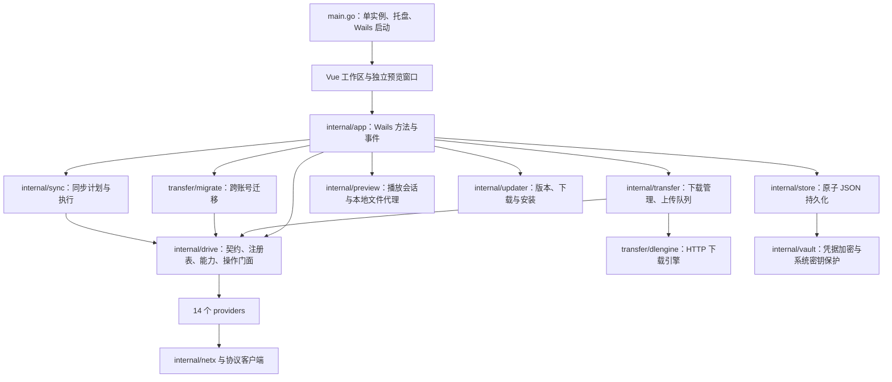

# Mnemo-Go 项目全貌与审查记录

审查日期：2026-10-30。源码基准：`8dc22c0`，应用版本：`0.4.6`。

本轮完成全仓目录清点、主要架构文档核对、关键调用链静态审查、自动化测试、漏洞扫描和 Windows 桌面编译。静态审查重点覆盖账号与凭据、驱动契约、文件操作、传输、迁移、同步、预览、更新及发布流程。结论不代表全部源码逐行证明，也不代表 14 个服务商的真实账号验收。

审查后已按用户要求实施上传、通知、侧栏和网盘范围调整，并修复可达依赖漏洞。工作区原有的未跟踪文件 `docs/Mnemo审计报告.md` 保持不变。下方规模与 F1–F7 的问题描述保留修复前基线，当前结果以本节和上传专项报告为准。

## 0. 实施结果与最终核验

当前保留 13 个网盘。一刻相册的驱动、注册、模型常量、图标、登录入口及在役功能矩阵已移除；没有修改用户本地账号数据。

- 阿里云盘修复结构化 `PreHashMatched` 识别、文件证明协商、父目录重复编码、实际返回名称和已知文件 ID 保留。秒传完成后不再继续分片或完成提交。空回执不会触发第二次创建；同名对象必须核对内容。
- 复查全部上传驱动。8 个具有本地秒传路径的驱动分别确认服务端完成回执；不为其他网盘虚构秒传能力。13 个上传驱动均在前置检查之后记录首次写入。
- 迅雷新增 GCID 秒传和 S3 PUT/multipart 上传，接入进度、限速、取消和完成确认。未实现迅雷分片的跨进程自动续传；没有使用真实账号验证套餐权限。
- 上传成功后的凭据保存失败单独通知，保留成功状态。上传、下载和迁移失败进入全局统一通知，任务行只显示“查看通知”，不再内联错误码和三角展开详情。
- 侧栏首项不再参与收缩，关闭滚动锚定；选中底色随原生滚动，使用 CSS 布局坐标。浏览器复现并修复 125% 缩放时约 37 像素的底色偏移。
- Dropbox 的 skip 改为服务端拒绝覆盖，处理查询后出现的同名文件；Dropbox、123、移动个人云传播检查点保存失败。前端上传冲突选择开始读取驱动能力，迅雷和 PikPak 不再提供覆盖按钮。
- F1/F2 已修复：`golang.org/x/net` 升级至 0.62.0，关联 Go 依赖按模块要求更新；建议工具链升至 Go 1.27.3。F7 的环境、凭据保存和迅雷范围说明已同步。

最终核验：`go test ./...`、`go test -race ./...`、`go vet ./...` 通过；`npm test` 为 36 个文件、302 项通过；`npm run build` 通过；Go 可达漏洞扫描报告 `No vulnerabilities found`。工作区浏览器完整流程、侧栏 100%/125%/150% 缩放滚动、拖拽排序持久化、后台失败通知及通知操作入口通过。广泛浏览器检查首次在设置页等待控件稳定时超时，复跑完整通过；未据此宣称真实服务商验收完成。

Windows 验证顺序为先 `npm run build`，再 `wails build -s -skipbindings -m -nosyncgomod -o Mnemo-review.exe`。产物为 `build/bin/Mnemo-review.exe`，大小 33,782,272 字节。编译使用 Go 1.27.3，已内嵌本轮前端。没有发布安装包，也没有启动真实账号写入验收。

仍需跟进：F3 同步运行状态、F4 同步退出等待、F5 取消错误的偶发竞争、F6 元数据缓存预算。本轮没有改动这些模块的实现。上传专项 F11 的跨进程持久回执仍有边界；F13 其他驱动的冲突策略尚未全部统一。真正无法确认的上传继续保留只读核对和显式“核对后重试”，不能将其一概取消。

## 1. 修复前基线总体判断

Mnemo-Go 已具有完整的多网盘桌面客户端结构。业务围绕统一账号、统一文件模型和驱动能力展开，覆盖浏览、整理、上传下载、跨账号迁移、目录同步、分享和在线预览。

项目已有较多针对数据安全和异常恢复的实现，例如凭据加密、原子持久化、下载资源身份检查、上传提交回执、迁移来源删除前复查、同步计划重新校验和预览会话隔离。现阶段的主要问题是可达依赖漏洞、同步运行状态与退出生命周期的缺口，以及文档与当前实现存在偏差。

本轮后端全量复跑、全量竞态检测、前端测试、静态检查和 Windows 桌面编译均通过。但首次后端测试出现一次下载取消相关的偶发失败；Go 漏洞扫描失败。因此不能将当前状态表述为“所有发布门槛均已通过”。

## 2. 项目规模与技术基线

统计范围为 `main.go`、`internal/**/*.go` 和 `frontend/src` 下的 `.vue/.js/.css`，不含生成绑定、依赖目录、构建产物及历史文档。

| 项目 | 本轮观察 |
|---|---|
| Go 生产文件 | 190 个，包含 `main.go` |
| Go 测试文件 | 154 个 |
| 前端生产文件 | 64 个 |
| 前端测试文件 | 35 个 |
| 生产代码总行数 | 75,354 行，包含注释和空行 |
| 测试代码总行数 | 34,285 行，包含注释和空行 |
| 已注册网盘 | 14 个 |
| 桌面框架 | Wails v2.14.0 |
| 前端 | Vue 3.5，纯 JavaScript，Vite 6，Vitest |
| Go 模块要求 | `go 1.26.0`，建议工具链 `go1.27.2` |
| CI 工具链 | Go 1.27.3、Node 24.22.0 |
| 本机核验环境 | Windows amd64、Go 1.27.2、Node 25.6.0、npm 11.19.1 |

体积较大的生产文件包括：`pan139.go` 2,916 行、`aliopen.go` 2,596 行、`PanView.vue` 2,270 行、`PreviewModal.vue` 2,210 行、`app.go` 1,954 行。后续维护需要控制这些文件继续集中职责；这不是本轮要求立即重构的理由。

## 3. 架构与模块边界



| 模块 | 实际职责与边界 |
|---|---|
| `main.go` | 内嵌前端资源，启动 Wails，处理单实例、托盘和独立预览子进程入口。 |
| `internal/app` | 应用装配、Wails RPC、状态事件、账号生命周期、任务入口、系统对话框、诊断与更新协调。 |
| `internal/drive` | `Driver` 契约、注册表、能力位、可选接口、统一操作门面、令牌回写、错误分类与文件元数据缓存。 |
| `internal/drive/providers` | 14 个网盘的认证、协议、元数据映射及具体操作实现。 |
| `internal/provider/webdav` | WebDAV 底层协议客户端；与驱动插件目录的职责不同，并非重复驱动。 |
| `internal/transfer` | 下载任务、目录下载、上传队列、恢复状态、上传提交回执、并发和限速设置。 |
| `internal/transfer/dlengine` | Range 探测、分段下载、单流下载、检查点、资源身份、重试、限速和提交前校验。 |
| `internal/transfer/migrate` | 跨账号迁移、秒传尝试、本地中转、项目结果、恢复检查点和移动来源清理。 |
| `internal/sync` | 本地与云端扫描、差异计划、冲突处理、计划复核、传输、删除保护及定时调度。 |
| `internal/preview` | 回环 HTTP 服务、播放会话、HLS/DASH 地址重写、字幕、本地文件授权和图片/文档缓存。 |
| `internal/store` | 账号、设置、目录缓存、标签、收藏、任务、分享、同步快照及删除记录的 JSON 持久化。 |
| `internal/vault` | AES-256-GCM，Windows DPAPI，macOS Keychain/Linux Secret Service，以及旧密钥文件兼容。 |
| `internal/netx` | HTTP 客户端、代理、上传传输、哈希和全局上传限速。 |
| `internal/captcha` | 官方安全验证页面、回调及服务商验证流程。 |
| `internal/updater` | 官方 Release 查询、版本比较、大小与 SHA-256 校验；Windows 安装交接，其他平台手动安装。 |
| `internal/logging` / `internal/localfs` | 日志等级、轮转与脱敏；平台磁盘可用空间查询。 |
| `frontend/src` | 页面、弹窗、双栏工作区、播放器、文档预览、偏好及 Wails 调用包装。 |
| `.github` / `tools` / `third_party` | 发布矩阵、依赖来源检查、许可证归档、SBOM 与构建来源证明。 |

前端没有采用 Vue Router 或 Pinia。主页面通过 `App.vue` 的页签状态组合；双栏由 `WorkspaceView.vue` 组合两个 `PanView`。共享逻辑分布在组合函数和普通 JavaScript 模块中。

## 4. 启动、运行与退出

1. `main.go` 先处理独立预览入口，再获取单实例、装配托盘并启动主窗口。
2. `App` 初始化持久化目录、账号目录、日志和设置。
3. 应用为 `drive` 注入令牌读取、令牌回写、密钥配置、上传会话和删除记录接口。
4. 应用创建预览代理、缓存、下载管理器、上传队列和迁移引擎。
5. 应用恢复任务记录、应用代理与限速设置，并启动同步调度和账号保活。
6. 前端通过 RPC 读取初始状态，通过事件接收传输、迁移、同步和账号变动。
7. 主窗口关闭可隐藏到托盘；真正退出进入 `Shutdown`。

下载、上传和迁移均有取消后等待 worker 收尾的实现。同步目前只有取消通知，缺少对应的退出等待，见问题 F4。

独立预览窗口运行在另一个 Wails 进程。父进程通过标准输入提供初始化配置，子进程通过带令牌的本机 RPC 调用白名单方法。账号存储和传输管理继续由主进程持有，避免两个进程同时管理同一批任务。

## 5. 网盘接入全貌

| 驱动 | 认证与需要理解的边界 |
|---|---|
| `pikpak` | 账密与官方验证码；支持云离线；服务端风控会影响登录与请求。 |
| `onedrive` | 系统浏览器 OAuth PKCE；个人版与企业版权限不同；本地删除记录不是完整云端回收站。 |
| `dropbox` | 系统浏览器 OAuth PKCE；根目录采用保守请求，挂载共享文件夹存在已记录的限制。 |
| `pan123` | 账密；实现搜索、分享、上传下载及回收站，实际权限受套餐约束。 |
| `lanzou` | 独立认证与网页协议；上传受类型和大小限制；回收站解析使用 `x/net/html`。 |
| `ilanzou` | 独立认证与协议实现；当前关闭搜索、分享创建和复制能力。 |
| `pan139` | 账密、短信及已有凭据入口；个人云、家庭云分开处理，分享存在空间限制。 |
| `pan189` | 账密、验证码、短信相关流程；个人云、家庭云独立处理。 |
| `yike` | BDUSS/Cookie；偏相册语义；关闭盘内移动、复制及永久删除能力。 |
| `aliopen` | Open Refresh Token；可选自有 OAuth 应用；默认中转会向 AList 令牌服务发送 Refresh Token，界面有明确同意项。 |
| `guangya` | 短信与已有令牌入口；实现云离线和分享，真实风控环境仍需账号验收。 |
| `thunder` | 当前代码已实现密码/短信登录、分享创建/撤销、回收站列表/还原；上传仍关闭。README 对此描述落后。 |
| `webdav` | 显式连接配置，支持认证协商和条件写入；没有统一云端回收站。 |
| `s3` | AWS S3/兼容接口、分片上传和预签名分享；权限取决于 bucket、prefix 与服务端策略。 |

能力由注册表、可选接口和账号能力快照共同表达。“驱动已实现”不等于当前账号一定有服务端权限。注册契约测试覆盖驱动数量、部分分享接口、收藏和云离线能力的一致性。

`gofile`、`gdrive` 未注册；加密盘、媒体服务器和 WebDAV 服务端不属于当前产品范围。

## 6. 关键业务链路与真实能力

### 文件浏览与搜索

`PanView → api.js → Wails App → drive 操作门面 → provider`。

目录状态按账号、空间、模式、目录和关键词隔离。前端先显示缓存，再后台刷新，并通过请求序号丢弃过期响应。列表具有虚拟显示逻辑。全局搜索先查本地目录索引，可选以两个并发请求查询支持搜索的网盘；缓存搜索不等同于全盘索引。

### 下载与上传

下载默认任务并发为 3，单文件请求并发为 8，单文件请求并发上限为 16。下载引擎使用 `.part` 和 `.state.json` 保存有效进度，并校验 Range、长度及可获得的资源身份。分段和单流分别维护检查点，避免把预分配文件长度当作已下载量。

上传由队列维护任务与 worker 代次。提交前保存 `pending`，提交后记录 `confirmed` 或 `unknown`；未确认的远端结果需要用户核对，避免直接重复上传。上传队列与同步/迁移直接调用上传接口属于不同的执行入口。

### 跨账号迁移

引擎设计顺序为：共同哈希秒传 → `StreamUploader` → 临时文件中转。

**当前 14 个生产驱动均没有实现 `StreamUploader`。** 注册契约测试也明确限制在补齐目标 ID 契约并重新审查前启用该接口。因此当前非秒传迁移实际使用本地临时文件逐文件中转，不能宣称生产驱动已经实现不落盘流式迁移。`PreviewMigration` 会识别中转模式并检查临时盘空间。

移动式迁移在删除来源前复查目标资源、大小和可比较哈希，再复查来源元数据。缺少目标身份、结果不明或检查点保存失败时保留来源。这些检查不是服务端事务，仍受服务商元数据与接口原子性限制。

### 同步

`SyncView → PreviewSync → Plan → RunSyncPlan → ExecutePlan` 是界面预览执行的主链路。普通手动执行和定时任务则通过 `executeSync → Engine.Run → ExecutePlan`。

计划绑定配置作用范围和两端元数据。执行前重新扫描，逐项检查来源/目标变化。默认保留冲突双方；删除传播默认关闭，超过快照一半的删除会被拦截。本地下载先写临时文件，替换前再次检查本地和远端状态。

### 预览与更新

播放代理绑定 `127.0.0.1` 随机端口，前端使用不透明会话地址。上游 URL、鉴权头和 HLS/DASH 子资源映射由 Go 进程持有。旧 `/proxy/` 入口已停用，本地文件只服务登记的授权文件。媒体会话有效期为 12 小时；图片/文档缓存预算为 1 GiB，过期时间为 7 天。

前端支持 HTML5 音视频、HLS、DASH、部分 TS 流及字幕，并按需加载 PDF、DOCX、XLSX、PPTX 预览器。文档预览依赖体积较大，生产构建产生多个超过 500 kB 的块，但构建成功。

更新器校验官方仓库、文件大小与 SHA-256。应用内更新没有内置发布者签名验证；CI 的 Artifact Attestation 是另一个验证层。Windows 支持安装器交接；macOS/Linux 自动替换尚未实现，需手动安装。

## 7. 存储与信任边界

- 账号记录保存在用户配置目录，其他数据优先放在可执行文件旁的 `data`，不可写时回退。
- 账号采用 AES-256-GCM 加密。Windows 使用 DPAPI；非 Windows 已有 Keychain/Secret Service 接入，旧 0600 密钥文件继续兼容。
- JSON 持久化使用临时文件、数据同步与原子替换。Windows 使用 `MoveFileEx` 的替换和写穿选项。
- 偏好备份采用字段白名单，不包含账号凭据。账号失效保留本机记录和缓存，要求重新授权。
- 令牌刷新需要区分登录失效、网络故障、限流和权限不足。`OperationIssue` 为界面提供结构化错误与下一步操作。
- 阿里默认令牌中转属于明确的外部信任边界。“本机加密保存”不能解释为“凭据绝不发送到第三方交换服务”。

## 8. 审查发现

### F1 / P1：存在可达的 `x/net/html` 漏洞，当前漏洞质量门槛不通过

证据：`go.mod:15` 固定 `golang.org/x/net v0.60.0`；`internal/drive/providers/lanzou/trash.go:55` 调用 `html.Parse`。`govulncheck` 报告该调用命中 `GO-2026-6860`，修复版本为 `v0.62.0`。

官方公告说明特制 HTML 可造成文本节点合并的二次复杂度分配与拷贝。这里的输入来自蓝奏回收站页面；扫描证明调用可达，不等于本轮已完成恶意页面利用测试。

建议升级 `golang.org/x/net` 到修复版本，检查关联依赖变化，再运行完整回归和漏洞扫描。CI 使用 Go 1.27.3 不会自动修复独立的 `x/net` 模块。

来源：[Go 漏洞数据库 GO-2026-6860](https://vuln.go.dev/ID/GO-2026-6860.json)。本轮已通过官方 JSON 接口核验，公告发布于 2026-10-27。

### F2 / P1（本地构建）：默认工具链仍会选到受影响的 Go 1.27.2

证据：`go.mod:5` 为 `toolchain go1.27.2`，本机实际也是 Go 1.27.2。`govulncheck` 命中 `GO-2026-6809`，调用链经过更新下载与证书验证，修复版本为 Go 1.27.3。

CI 在 `.github/workflows/release.yml:20` 已固定 Go 1.27.3。因此不能据此断言 CI 的新构建仍使用旧标准库；问题是本地默认工具链和文档仍落后。本轮桌面编译产物仅用于编译核验，不应当作通过安全门槛的发布包。

建议将本地建议工具链与 CI 统一到已修复版本，并同步开发环境说明。

来源：[Go 漏洞数据库 GO-2026-6809](https://pkg.go.dev/vuln/GO-2026-6809)。

### F3 / P2：预览执行同步没有持久化运行状态

证据：`frontend/src/views/SyncView.vue:51` 调用 `RunSyncPlan`；`internal/app/sync.go:315` 直接调用 `beginSyncRun` 和 `ExecutePlan`。`beginSyncRun` 只登记内存状态、发送事件。只有 `executeSync` 在 `sync.go:74` 附近保存运行中和结束状态。

影响：预览执行完成或失败时，当前页面可依靠事件显示结果；重新挂载页面或重启后，`ListSyncRunStates` 读取的可能仍是旧记录。旧失败原因无法被本次成功清除；预览执行中断也可能没有运行中记录可供恢复提示。

建议让所有同步入口共用运行状态持久化与结束处理，保留预览令牌校验和冲突选择参数。需要覆盖预览执行的成功、失败、取消和重启恢复。

验证级别：静态调用链确认；本轮未修改实现。

### F4 / P2：退出取消同步后没有等待同步结束，也没有阻止新增同步

证据：`internal/app/app.go:476` 调用 `cancelAllSyncRuns`；`internal/app/sync.go:172` 仅遍历并执行取消函数，没有完成通知或等待。`beginSyncRun` 也没有退出状态检查。调度器收到停止信号后取消上下文并返回，没有等待已启动任务。

影响：`Shutdown` 可能在同步完成状态保存、临时资源清理或在途上传收尾前返回。退出过程中进入的同步还可能错过已有任务的取消快照。与下载、上传、迁移的退出等待行为不一致。

建议为同步运行增加完成通知和关闭标记，先拒绝新增运行，再取消并等待全部同步退出。需要覆盖进行中任务和退出竞态；本轮没有将该缺口表述为已复现的数据损坏。

验证级别：静态生命周期确认。

### F5 / P2（测试稳定性）：下载检查点测试出现一次取消错误竞争

首次 `go test ./...` 中，`TestPeriodicCheckpointPreservesInFlightPrefix/stream=true` 失败。`stream_resume_test.go:205` 期待 `context.Canceled`，实际收到 `unexpected EOF`；当时保存的检查点含 `stream_bytes:4096`，临时文件读取没有报错。

该测试随后连续 20 次通过；全量竞态测试和不使用缓存的全量复跑也通过。`singleStream` 在 `segment.go:1014` 直接返回正文读取错误，`idleBody.Read` 只专门归一化空闲超时，取消与底层连接关闭存在需要继续定位的竞争窗口。

建议继续定位取消时的错误归一化和测试服务端退出时序。检查点已经保存，当前证据不能证明断点数据丢失。下载管理器另有 `ctx.Err()` 判定，不能直接把此测试失败等同于用户暂停必然显示失败。

### F6 / P3：后端文件元数据缓存缺少容量和过期预算

证据：`internal/drive/filecache.go:19` 使用全局 `byKey`、`byDir` 映射；`RememberListedFiles` 只替换同一目录的记录。未发现容量上限或 TTL。清理依赖显式清缓存或重新列出同一目录。

影响：长时间浏览大量不同目录会累计文件元数据；前端缓存和图片缓存有预算，并不能约束这份后端缓存。本轮未进行长期内存压测，也不据此给出固定内存增量。

建议增加按账号的容量预算或 LRU/TTL，保留直接预览和安全操作需要的元数据契约。

### F7 / P3：公共说明存在多处可证实的漂移

| 位置 | 当前描述与实现的差异 |
|---|---|
| `AGENTS.md:18` | 写 Go ≥1.25、Node ≥20；当前模块要求 Go 1.26，前端要求 Node ≥24.22.0。 |
| `README.md:138`、`docs/SUPPLY_CHAIN.md:36` | 写 CI Go 1.27.2；工作流已固定 1.27.3。 |
| `README.md:97` | 写迅雷短信未核实、分享和回收站浏览/还原未开放；当前代码和驱动文档已有实现，真实账号验收仍是另一项工作。 |
| `AGENTS.md:32` | 对 macOS/Linux 仅描述兼容密钥文件；当前代码已有 Keychain/Secret Service 接入。 |
| `README.md` 迁移描述 | 容易使人理解为当前生产驱动已具备不落盘流上传；实际没有 `StreamUploader` 适配器。 |

建议以当前实现和明确验收边界更新入口文档，避免同时把旧审计报告、设计目标和实现事实当作当前状态。

## 9. 修复前基线验证结果

| 检查 | 结果 |
|---|---|
| `npm test` | 35 个测试文件、297 项测试通过。Node 25 下有 `--localstorage-file` 警告。 |
| `npm run build` | 通过；存在第三方预览/播放器大块警告。 |
| 首次 `go test ./...` | 下载检查点测试偶发失败，其余包通过。 |
| 下载检查点定向复跑 `-count=20` | 通过。 |
| `go test -count=1 ./...` | 全量通过。 |
| `go test -race ./...` | 全量通过；未报告数据竞争。 |
| `go vet ./...` | 通过。 |
| `go build ./...` | 通过。 |
| `gofmt -l main.go internal` | 无输出。 |
| `node --test tools/supply-chain.test.cjs` | 7 项通过。 |
| `node tools/supply-chain.cjs check` | 通过，272 项依赖来源检查。 |
| `npm audit --audit-level=high --json` | 报告漏洞总数为 0；外部 tarball 等输入的覆盖仍以该工具能力为限。 |
| `go run golang.org/x/vuln/cmd/govulncheck@v1.9.0 ./...` | 失败：2 项可达漏洞；另报告 1 项导入包级但未发现符号调用的漏洞。 |
| Windows Wails 生产模式编译 | 通过；使用已构建前端和现有绑定，跳过 mod tidy 与 go.mod 同步。 |

桌面编译命令：

```powershell
wails build -s -skipbindings -m -nosyncgomod -o Mnemo-review.exe
```

核验文件为 `build/bin/Mnemo-review.exe`，33,775,104 字节。没有清理原构建目录，没有覆盖默认的 `Mnemo.exe`。未启动该程序、未生成安装包、未发布。

本轮未运行：

- 14 个真实网盘账号的登录、短信、验证码、真实上传下载和分享操作。
- 需要显式开关的真实家庭云只读诊断。
- `frontend/workspace.browser.cjs` 浏览器工作区验收；本机当前 Node 解析路径下没有安装 Playwright。
- Linux/macOS 原生编译、运行和安装包验收。
- 长时间运行、大规模目录、极低速网络及异常退出压测。
- 安装器执行、更新交接和发布来源证明的线上验证。

## 10. 后续修改定位

| 需求 | 优先定位 |
|---|---|
| 新增网盘 | `drive/driver.go`、`registry.go`、`capabilities.go`、`providers/<id>`、`providers/all.go` |
| 登录、账号恢复 | provider 的认证实现、`app/app.go`、`keepalive.go`、`LoginModal.vue`、`login-schema.js` |
| 文件列表、双栏、操作菜单 | `PanView.vue`、`WorkspaceView.vue`、`api.js`、`app/drive.go`、`drive/ops.go` |
| 下载与断点 | `transfer/manager.go`、`folder_download.go`、`dlengine/segment.go`、`http.go`、`checkpoint.go` |
| 上传与重试 | `transfer/upload.go`、`upload_receipt.go`、驱动上传实现 |
| 迁移及来源删除 | `app/workspace.go`、`transfer/migrate/engine.go`、`verify.go` |
| 同步与数据保护 | `app/sync.go`、`sync/plan.go`、`sync/engine.go`、`store/sync_state.go`、`SyncView.vue` |
| 播放与文档预览 | `app/player.go`、`preview_window.go`、`preview/server.go`、`PlayerPanel.vue`、`DocumentPreview.vue` |
| 凭据与持久化 | `store/accounts.go`、`durable_write.go`、平台替换实现、`vault` |
| 更新与发布 | `updater`、`app/updater.go`、`release.yml`、`tools/supply-chain.cjs` |

F1/F2 已修复并重新通过漏洞门槛。后续建议先统一同步运行状态和退出协议，再定位偶发测试并约束元数据缓存。功能实现与真实服务验收继续分别记录。
